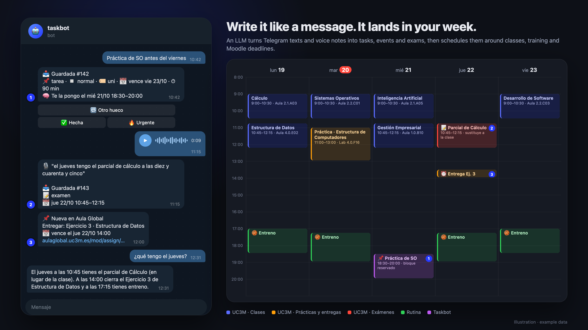
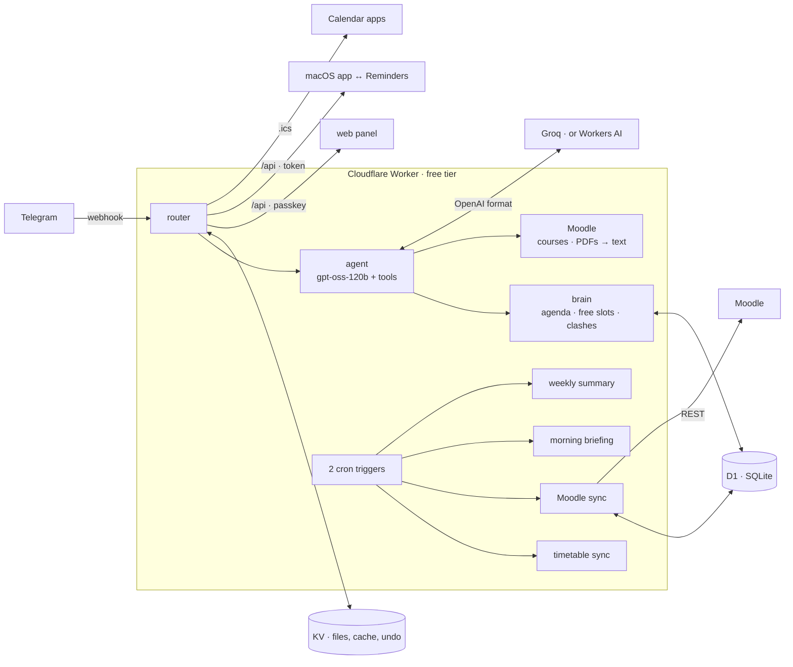

# taskbot

**A personal assistant for students, run from a Telegram chat.**


<sub>Illustration with example data: what you send on Telegram (left) and where it lands in the subscribed calendars (right).</sub>

Messages to yourself, deadlines in Moodle, the timetable on a university website, training in your head: taskbot puts all of it in one place. You text it, forward it an email or send a voice note, and an LLM with tools works out what you meant and writes it into one agenda that already knows your classes, exams and deadlines. It finds free slots for your tasks, warns about clashes, and answers questions from the real data, including what your professor's own course plan says you will do in tomorrow's class.

It costs **€0/month**: Cloudflare's free tier, open-weight models, vanilla JavaScript, no npm dependencies and no build step. The bot speaks Spanish.

> 🇪🇸 Full usage guide in Spanish: [docs/GUIA.md](docs/GUIA.md) · Install your own: [DEPLOY.md](DEPLOY.md)

## What it does

| You send on Telegram | What happens |
|---|---|
| "Meeting with Ana on Thursday at 17:30" | 📅 Event with an alarm, plus a warning if it clashes with a class or training |
| "Finish the OS lab before Friday, it'll take me 3 hours" | 📌 Task with a 3-hour block booked in a free slot before the deadline |
| A pasted hackathon announcement: "8–12 November, times TBC, submit on the 11th at 23:59" | 📅 Five all-day days marked *times to be confirmed*, a deadline, and a warning that the 9th clashes with an exam. Three days before, it asks for the times |
| "Day 1 is 17–22, the middle days 9–21, the last one until 14" | 🕐 Sets the right hours on each day of that event |
| A forwarded email from a teammate | 📥 Pulls out every meeting and task in it at once |
| "What are we doing tomorrow in Software Engineering?" | 📚 Reads the course's schedule PDF in Moodle and tells you the session's topic and the in-class exercise |
| "Calculus midterm on 26 October at 10:45" | 📝 Exam. It replaces that day's Calculus class in the calendar |
| "No game this Saturday" · "Move the gym to 7" | ❌ / ✏️ Changed in place, with one ↩️ Undo button for everything a message did |
| A voice note | 🎙 Transcribed with Whisper and handled like text |

If something essential is missing ("dinner with my parents"), it asks instead of guessing.

Without being asked, it also:

- **Watches Moodle every hour.** New assignments and quizzes become tasks, submitted ones are marked done and changed deadlines trigger an alert. Reminders go out 24 h and 3 h before each deadline, and teacher announcements are forwarded. Every 3 h it checks for new material and grades.
- **Re-reads the university timetable every 3 h** and reports room changes and added or cancelled sessions (UC3M).
- **Sends a morning briefing at 7:45** with the day's classes, events, overdue tasks and free slots.
- **Publishes calendar feeds** (classes, labs and deadlines, exams, routine, tasks) that Apple or Google Calendar subscribe to.
- **Closes the day at 22:45**: whatever was left pending (overdue tasks, today's unfinished blocks) comes with buttons to mark it done or push it to tomorrow, one by one or all at once.
- **Reads your email** (optional): your accounts forward to an address of yours that the Worker receives. Newsletters are dropped without AI, and the model is told to be very selective. It only messages you when an email asks you to do something or brings a date, with a button to add it. Nothing is added unless you tap.
- **Checks its own health every night**: Telegram webhook, Groq, Notion, the message queue and Jarvis (GitHub token, Modal, the calling account's session). It only writes if something broke, and says how to fix it. `/salud` runs it on demand.
- **Sends a weekly summary on Sundays**: your commits and your organisations', tasks closed, hours of class and a "build in public" draft.
- **Nudges you when there is something worth posting on X** (optional). It reads official AI blogs, Hacker News, GitHub Trending and Product Hunt, scores how hot each topic is across sources and writes drafts in your voice. It never posts anything itself.

Two clients read the same API:

- **A web panel** (vanilla JS PWA, installable on iOS): today's agenda and free slots, Moodle deadlines and tasks split by subject, and the weekly summary. It signs in with a passkey (Face ID), using WebAuthn written by hand. If no passkey is at hand, `/acceso` in Telegram sends a one-time link.
- **A native macOS app and widget** (SwiftUI, WidgetKit). It syncs both ways with Apple Reminders.

## Modules

Everything personal lives in an untracked `config.js` ([template](config.example.js)). Each module is a block in it; remove the block to turn the module off.

| Module | Needs | Notes |
|---|---|---|
| Assistant, agenda, tasks, calendar feeds, panel | Telegram + Cloudflare (free) | The core |
| Moodle (`aulaGlobal`) | The Moodle mobile app token of your account | Any Moodle site; read-only |
| University timetable (`uc3m`) | Your enrolment | UC3M's public timetable site. Elsewhere, remove it and add classes as routine or events |
| Weekly summary (`weekly`) | Optional `GITHUB_TOKEN` | Without the token, public repos only |
| X assistant (`social`) | Nothing | Sources, cadence and your voice are in the config |
| Notion (`notion`) | `NOTION_TOKEN` (internal connection or personal token) | A team or club workspace: dated events → calendar feed and agenda, tasks assigned to you → tasks, and the assistant searches and reads its pages. Read-only |
| Website inbox (`panel.inbox`) | Another Worker of yours | Contact-form messages and bookings pushed over a service binding ([contract](src/inbox.js)) |
| Email (`mail`) | Cloudflare Email Routing on your domain (free) | Gmail or your university account forward to `mail.address`; only mail forwarded by `mail.forwarders` is accepted. The email itself is not stored |
| Jarvis (`jarvis`) | A second Telegram account, a private GitHub repo, optional Modal | Calls you at wake-up time or on `/llamame` and talks: asks, answers and adds things with the assistant's tools ([jarvis/](jarvis/)) |
| Health check (`health`), day close (`evening`) | Nothing | On by default; set to `null` to turn off |
| Faster model (Groq) | Optional `GROQ_API_KEY` (free) | Same model; otherwise Workers AI |

## Architecture



## Engineering notes

- **An agent with the bot's own building blocks as tools.** The model (gpt-oss-120b, open weights) gets the resolved calendar for the next two weeks and what is saved, then calls tools such as `crear_evento`, `crear_tarea`, `fijar_horario`, `ver_agenda` and `aula_asignatura`. Those reuse the same scheduler, clash detection and undo snapshots as the rest of the bot, so the model never computes free slots itself. Groq runs it first; if Groq is down or out of quota, the same model runs on Workers AI. If both fail, the message is saved as a plain task: nothing is ever lost.
- **Multi-day events are one row per day,** linked by a `series` id. The agenda, the free-slot finder, the panel and the `.ics` feeds keep working per day without special cases. All-day days with *times to be confirmed* block the whole day for task scheduling.
- **The course plan is read from the PDF.** Professors publish the session-by-session plan as a PDF. The assistant finds planning documents in a course, converts them with Workers AI `toMarkdown`, caches the text in KV until the file changes, and answers from the row for that date.
- **Seven jobs on two cron triggers.** The free plan allows five cron triggers per account, shared by every worker. The `:45` trigger picks its work from the hour: timetable or material sync by `hour % 3`, the morning briefing, nightly cleanup and the Sunday summary. That tick skips the X assistant to stay under the 50-subrequest limit.
- **Passkeys without a library.** Registration and sign-in are verified with WebCrypto, a small CBOR decoder for the attestation and COSE key, and DER-to-raw conversion for ES256 signatures. Sessions are HttpOnly `SameSite=Strict` cookies whose SHA-256 is all that is stored. Non-GET requests must come from the panel's origin, and challenges and recovery links are single-use.
- **Exams and cancellations are an override layer** on top of the generated fixed schedule, so undoing one or moving an exam brings the class back.
- **Moodle sync is idempotent and read-only.** Every imported item carries a unique `source` key (`ag:assign:123`), so hourly runs update in place, and a deadline change shows up as a diff.
- **Each surface has its own credential.** The browser uses a passkey session, the macOS app a bearer token and the calendar feeds a third token, because calendar servers poll the `.ics` URL. If that URL leaks, only the calendar token needs rotating.

## Stack

Cloudflare Workers · D1 · KV · Workers AI (gpt-oss-120b, Llama 3.3 70B, Whisper, toMarkdown) · Groq (optional) · Telegram Bot API · Moodle Web Services · WebAuthn · iCalendar (RFC 5545) · vanilla JS PWA · SwiftUI, WidgetKit and EventKit

About 4,000 lines of JavaScript in `src/` and 1,500 in the panel, plus the Swift app.

## Install your own

You need Node, a free Cloudflare account (no card) and Telegram. [DEPLOY.md](DEPLOY.md) has every step, and is written so Claude Code can follow it for you. In short:

```bash
cp config.example.js config.js && cp wrangler.example.toml wrangler.toml
npx wrangler d1 create taskbot && npx wrangler kv namespace create FILES   # ids → wrangler.toml
npx wrangler d1 execute taskbot --remote --file=schema.sql
npx wrangler secret put TELEGRAM_TOKEN   # plus TG_WEBHOOK_SECRET, DASH_TOKEN, CAL_TOKEN, OWNER_CHAT_ID
npx wrangler deploy
```

Times are Madrid time throughout.

## Project layout

```
src/              Worker: agent, llm, telegram, brain, calendar, aulaglobal, auth, …
public/           web panel PWA (no framework, self-hosted Archivo)
public/brand.default/   neutral logo and icons; put yours in public/brand/ (untracked)
macos-widget/     native macOS app + widget (xcodegen)
schema.sql        D1 schema · migrations/ for existing databases
docs/GUIA.md      full usage guide (Spanish)
```

## License

[MIT](LICENSE)
